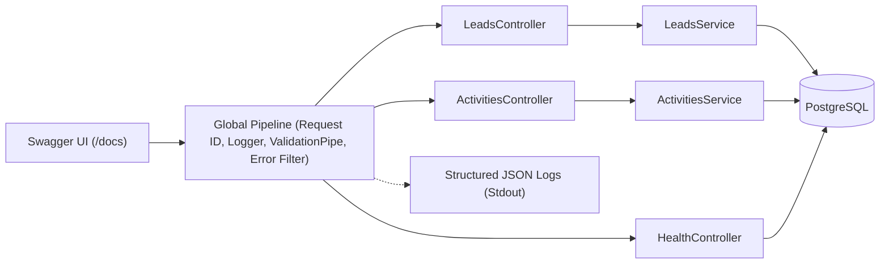
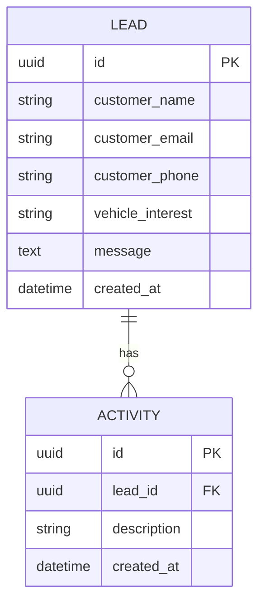
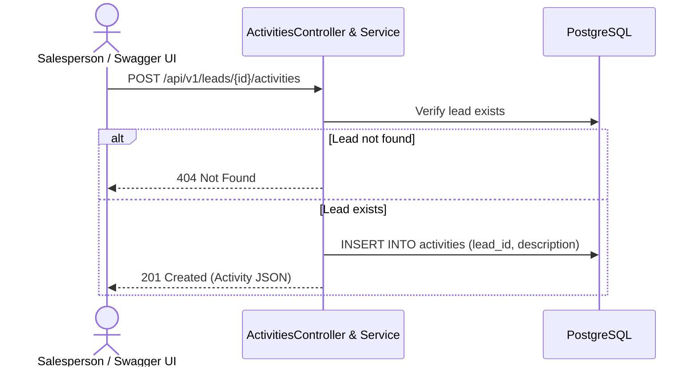

# System Design Document: Sales Lead Management Tool (Scenario C)

## 1. Overview & Assumptions

This design covers **Scenario C: The Sales Lead Management Tool** (Domain: **Demand**), implemented as a **Backend REST API** using **NestJS**, **TypeScript**, **Swagger (OpenAPI 3.0)**, and **PostgreSQL**. The client-side layer is stubbed via the **OpenAPI 3.0 contract** and interactive **Swagger UI (`/docs`)**.

### Core Requirements
1. **Lead Inbox:** List all incoming sales leads (`GET /api/v1/leads`).
2. **Lead Details View:** Return full lead details with a chronological log of all follow-up activities (`GET /api/v1/leads/:id`).
3. **Activity Logging:** Persist a new follow-up activity for a lead, e.g., `"Called customer"` (`POST /api/v1/leads/:id/activities`).

### Key Assumptions
- **Scope:** Single-salesperson prototype without authentication/authorization (auth is assumed to be handled by an upstream gateway if needed later).
- **Lead Source:** Incoming website leads are pre-seeded in PostgreSQL for demo and testing.
- **Chronological Order:** Follow-up activities are sorted oldest-to-newest (`createdAt ASC`) so salespeople read the interaction history in chronological order.
- **Pagination:** `GET /api/v1/leads` returns a straightforward list of incoming leads for prototype simplicity, with pagination noted as a future scalability option.

---

## 2. System Architecture

### Architecture Diagram

### Component Roles

| Component | Role |
| :--- | :--- |
| **Global Pipeline** | Validates DTOs (`ValidationPipe`), formats errors uniformly, attaches `X-Request-Id`, and emits JSON request logs. |
| **Swagger Module** | Auto-generates OpenAPI 3.0 docs and serves interactive Swagger UI at `/docs`. |
| **LeadsModule** | Handles Lead Inbox queries (`GET /api/v1/leads`) and Lead Details with chronological activities (`GET /api/v1/leads/:id`). |
| **ActivitiesModule** | Validates and persists new follow-up activities (`POST /api/v1/leads/:id/activities`). |
| **HealthModule** | Provides `GET /api/v1/health` to verify app liveness and PostgreSQL connectivity. |

---

## 3. Data Model & API Endpoints

| Method | Path | Purpose |
| :--- | :--- | :--- |
| `GET` | `/api/v1/leads` | List incoming leads for the Lead Inbox (`created_at DESC`) |
| `GET` | `/api/v1/leads/:id` | Full lead details + chronological follow-up activity log (`created_at ASC`) |
| `POST` | `/api/v1/leads/:id/activities` | Log and persist a new follow-up activity for a lead |
| `GET` | `/api/v1/health` | Service and PostgreSQL readiness check |

---

## 4. Data Flow

1. **Lead Inbox (`GET /api/v1/leads`):** `LeadsService` queries `leads` ordered by `created_at DESC` without joining child activities and returns the lead list.
2. **Lead Details (`GET /api/v1/leads/:id`):** Validates the lead UUID -> fetches the lead and its `activities` sorted by `created_at ASC` -> returns `404` if missing, or full lead details with chronological activities.
3. **Activity Logging (`POST /api/v1/leads/:id/activities`):**

---

## 5. Technology Stack & Justifications

| Choice | Justification |
| :--- | :--- |
| **NestJS + TypeScript** | Modular DI architecture, strong typing across DTOs/entities, and clean separation for unit testing. |
| **`@nestjs/swagger`** | Generates OpenAPI 3.0 spec and Swagger UI directly from DTO decorators—doubles as API contract and demo client. |
| **PostgreSQL + TypeORM** | Reliable relational persistence, foreign key integrity, and standard SQL indexing. |
| **`class-validator`** | Declarative request validation integrated with `ValidationPipe` and Swagger schemas. |
| **Pino JSON Logger** | Fast structured logging with request-ID correlation. |
| **Jest + Supertest** | Built-in test runner for fast unit tests and HTTP integration tests. |

---

## 6. Observability & Future-Proofing

- **Logging:** Structured JSON logs per request (`requestId`, `method`, `path`, `statusCode`, `durationMs`); customer email/phone are omitted from logs to protect PII.
- **Health & Metrics:** `GET /api/v1/health` checks PostgreSQL connectivity (`SELECT 1`). Request duration and status codes are logged cleanly for RED metrics (`Rate`, `Errors`, `Duration`).
- **Tracing:** Middleware propagates or generates `X-Request-Id` on every request/response and is ready for OpenTelemetry auto-instrumentation.
- **Scalability & Reliability:** Stateless API instances can scale horizontally behind a load balancer; indexes on `leads(created_at)` and `activities(lead_id, created_at)` keep queries fast, and pagination/auth can be added cleanly without breaking core flows.

---

## 7. GenAI Collaboration in Design

- **Scope Selection:** Used **Google Antigravity** to compare all four scenarios and pick **Scenario C (Backend)** for the cleanest vertical slice and strongest testability.
- **Clarifying Ambiguities:** Identified unstated details (auth boundary, chronological sort order, seeded incoming leads) and documented clear assumptions.
- **Human Ownership:** Stripped out non-essential features (status workflows, salesperson attribution, and extra activity fields) so the design stays strictly aligned with Scenario C and easy to present in a 5–10 minute demo.
